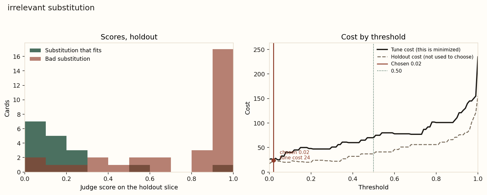
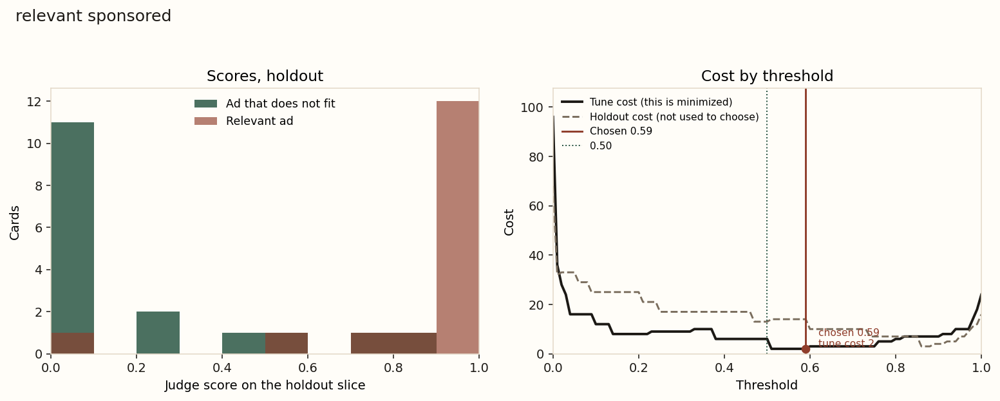

# One judge, two decisions on a search page

The [interactive page](./index.html) is the way to read this on a phone. It loads the scored cards and lets you move the cutoffs, the costs, and which score is used. This file is the run-it-yourself version: setup, the command, and the same numbers in a form you can diff.

This is a worked example you can run. It takes the idea from last night's [eval threshold tuner](../../demos/2026-10-21-eval-threshold-tuner/) and puts a real model under it.

Last night's page moves a cutoff across synthetic scores. The idea is from [Hamel Husain's post](https://x.com/HamelHusain/status/2112588257104216294) about the essay [How To Use Decision Models for Evals](https://hamelhusain.substack.com/p/how-to-use-decision-models-for-evals) by Hamel Husain and Antaripa Saha. A judge returns a score from 0 to 1. A cutoff turns that score into a decision. 0.50 is a common default. It is a guess until you price the mistakes.

Here the judge looks at grocery and retail search cards. One local model answers one question: does this product fit the query? Two decisions use that answer:

1. Flag an irrelevant substitution (oat milk offered in place of whole milk).
2. Keep a sponsored ad that actually fits, and drop one that does not.

The cards, the labels, and the scores below are from the run committed in `outputs/`. The full printout is [`outputs/REPORT.txt`](outputs/REPORT.txt).

## Step 1. Set up and run

From this folder:

```bash
python3 -m venv .venv
source .venv/bin/activate
python -m pip install -r requirements.txt
python run.py
```

`./run.sh` does the same thing in one command. It installs the pinned CPU packages only if `torch`, `transformers`, or `matplotlib` cannot be imported, then runs `run.py`.

The first scoring run downloads `Qwen/Qwen2.5-1.5B-Instruct` (about 2.9 GB on disk) and loads it in bfloat16. The run committed here scored 244 cards in 141 seconds on a 4-core CPU. After that, `python run.py` reuses `outputs/scores.jsonl` when the model, the prompt version, and the dataset hash still match. Editing `costs.json` redraws the cutoffs and the charts without calling the model.

Useful flags:

- `--rescore` calls the model again.
- `--reuse-scores` exits if the saved scores do not match. It will not download anything.

Environment variables, all optional:

| Variable | Role |
| --- | --- |
| `JUDGE_BACKEND` | `local` (default) or `openai` |
| `JUDGE_MODEL` | Hugging Face model id. Default `Qwen/Qwen2.5-1.5B-Instruct` |
| `JUDGE_REVISION` | Checkpoint hash. The default model is pinned |
| `JUDGE_DTYPE` | `bfloat16` (default), `float32`, or `float16` |
| `JUDGE_BATCH` | Cards per forward pass. Default 4 |
| `JUDGE_THREADS` | CPU threads for PyTorch. Default 4 |
| `OPENAI_BASE_URL` | For example `http://127.0.0.1:8080/v1` |
| `OPENAI_MODEL` | Model name sent to that server |
| `OPENAI_API_KEY` | Sent as a bearer token when it is set |

`JUDGE_BACKEND=openai` uses the same Yes/No formula on the top logprobs the server returns. If the server does not send logprobs, or Yes and No are both missing from them, the run stops. A typed "yes" is not a score.

## Step 2. What each file does

- `run.sh` is the one command.
- `run.py` loads the cards, gets a score for each, picks a cutoff on the tune split, and writes `outputs/`.
- `costs.json` is the price of a false positive and a false negative for each decision. Edit this first.
- `data/cases.py` is the hand-labeled dataset. Every card has a note.
- `dataset.py` checks the labels, derives the two decisions, and holds the rules text the prompt uses.
- `judge.py` builds the prompt and reads P(fits) from the next-token distribution.
- `baseline.py` is keyword overlap. No model.
- `metrics.py` is precision, recall, cost, and the cutoff search. `test_metrics.py` checks the arithmetic on toy rows.
- `charts.py` writes the two PNGs.
- `test_dataset.py` checks that the hard cards stay hard. The word "gallon" does not appear on the 128 fl oz card, and "olive" does not appear on the EVOO card.
- `outputs/REPORT.txt` is the text report from the committed run. `outputs/results.json` is the same numbers as JSON. `outputs/curves.json` is the cost at every cutoff from 0.00 to 1.00.

## Step 3. The cards, the rules, and why one question becomes two decisions

There are 40 made-up queries and 244 cards. 24 queries are the tune split (the cutoff is chosen here). 16 are held out (the numbers you would quote). A query never appears in both splits, so the cutoff cannot memorize that query's wording.

Each card has a badge the store UI already printed: `organic`, `substitution`, or `sponsored`. The human label is `fits`: 1 when the product is the item the query asks for, 0 when it is not. The rules are the string `RULES` in `dataset.py`. The prompt pastes that same string, so the model is graded against a spec it was shown.

A few of those rules are equivalences a keyword counter cannot see:

- 2% milk and reduced fat milk are the same. Vitamin D milk, with no other fat named, means whole milk.
- 64 fl oz is a half gallon. 128 fl oz is a gallon. EVOO means extra virgin olive oil.
- Preserves count as jam. Jelly does not. Pure olive oil is not extra virgin. Diet cola is not cola. A mega roll is not a double roll. Dishwasher pods are not dish soap. A cooking spray is not a bottle of oil.

Everything else is ordinary: a named size, count, flavor, or dietary word has to match, a different brand is fine when none was asked for, and a neighbor in the aisle does not fit. Oat milk is not whole milk.

You asked for one model that detects irrelevant substitutions and relevant sponsored ads. Those are two decisions, and they share one judgment. The badge is already on the card, so the model is not asked to rediscover it. The prompt asks only "does this product fit?" Python then builds the decision score:

- On a substitution, the action is "flag this as irrelevant." The score is `1 - P(fits)`. High means the swap looks bad.
- On a sponsored card, the action is "keep this ad." The score is `P(fits)`. High means the ad looks relevant.

Organic cards stay in the file so a results list is not only swaps and ads. Neither cutoff is tuned on them. This system does not grade ordinary ranking.

The positive class is uneven, and that matters when you read precision:

- Irrelevant substitutions, holdout: 31 of 48 cards are bad swaps. Base rate 64.6%. Flagging every swap would have that precision.
- Relevant ads, holdout: 16 of 33 ads fit. Base rate 48.5%.

## Step 4. How the prompt is built

`judge.messages` returns two chat messages. The system message tells the model to say Yes only when the product is the same item and every named requirement is met, and to say No for a different product or a missed requirement. The user message is the rules, then the query, the product title, and the details. It ends with `Yes or No:`.

The badge is not in the prompt. Showing "substitution" might nudge a small model to treat every swap as bad. The baseline does not see the badge either, except as the slice it is scored on.

The local backend wraps those two messages in the model's chat template and asks for the next token after the assistant header. The templated prompt for the first card is `outputs/example_templated_prompt.txt`. It is 380 tokens. The longest card in this set is 397. Nothing is truncated.

The OpenAI-compatible backend sends the same two messages to `/chat/completions` with `temperature` 0, `max_tokens` 1, and `logprobs` on.

## Step 5. How the score is pulled out

The model is not asked to type 0.70. A typed number is not a probability, and small models are unreliable at writing one. We take the softmax over the whole vocabulary at the next token, add up the probability of the Yes tokens, add up the No tokens, and divide:

```text
P(fits) = P(Yes tokens) / (P(Yes tokens) + P(No tokens))
```

On this tokenizer the Yes set is the single tokens `Yes`, `yes`, `YES`, and the same words with a leading space. Same for No. Forms that split into several tokens are ignored, so a prefix is not counted twice. The token ids are in `outputs/results.json` under `model.yes_tokens`.

On this run the Yes tokens and the No tokens together hold essentially all of the next-token mass (mean 1.000). Zero cards put less than half their mass on Yes or No. The model is answering the question. bfloat16 can make the two masses sum to 1.002 on a card. The ratio is what we keep.

Three cards from the committed scores:

- Highest P(fits), 1.000. `lactose-milk-01`, an organic card, "Lactaid Whole Milk", and the label says it fits. The top token is `Yes` at 1.000.
- Lowest P(fits), 0.000. `litter-03`, "Fresh Step Clean Paws", details "scented, 20 lb", query "unscented cat litter". The label says it does not fit. The top token is `No` at 1.000.
- Closest to 0.50. `broth-06`, tune split, sponsored "Campbell's Chicken Noodle Soup" for "chicken broth low sodium". The label says it does not fit. `Yes` and `No` are each 0.500, so P(fits) is 0.500. A cutoff of 0.50 would keep this ad. This card was in the tune split, so the cutoff was allowed to see it. It is here to show the arithmetic, not as a holdout result.

`1 - P(fits)` is the substitution score. The soup card is sponsored, so it never enters that detector.

## Step 6. The keyword baseline

`baseline.fit_score` is the share of query tokens that appear in the title or the details. Apostrophes are stripped so "men's" matches "mens". Digits stay, because "size 10" and "8 pack" are the requirement. The same `decision_score` function turns that overlap into a detector score: `1 - overlap` for swaps, `overlap` for ads.

It does not get the equivalence list. "EVOO" shares no tokens with "extra virgin olive oil", so its overlap is 0. "64 fl oz" shares no tokens with "half gallon". "half gallon" does contain the token `gallon`, so a half-gallon card still matches a query that asks for a gallon. "fluoride-free" still contains the token `fluoride`. Those are the baseline's blind spots, and they show up in the holdout disagreements in step 8.

The baseline gets its own cutoff, chosen on the tune split with the same costs. A threshold of 0.30 on overlap is not the same decision as 0.30 on the model, so the two curves are not drawn on one chart.

## Step 7. How the threshold is chosen, and why

Predict positive when `score >= threshold`. Cost is `false positives × fp cost + false negatives × fn cost`. The search tries 0.00, 0.01, …, 1.00. Ties go to the higher cutoff, which fires on fewer cards. That is the same grid and the same tie-break as the tuner demo. The code is `choose_threshold` in `metrics.py`.

The costs in `costs.json`:

- Irrelevant substitution. Flagging a swap that actually fits costs 1. Letting a bad swap through costs 5. Missing the bad swap is the expensive mistake, so the search is willing to flag more.
- Relevant sponsored ad. Keeping an ad that does not fit costs 4. Dropping an ad that fits costs 1. A junk ad is the expensive mistake, so the search is willing to keep fewer ads.

A toy version of the essay's picture is the first test in `test_metrics.py`. Five positives scored 0.40 and five negatives scored 0.10. A cutoff of 0.50 flags nothing. With equal costs the cheap cutoff is 0.40. These search cards are not that clean. Good and bad scores overlap, which is why the chart is worth looking at.

The cutoff is chosen on the tune split only. The holdout numbers use that frozen cutoff. `REPORT.txt` also prints an "oracle" cutoff fit on the holdout itself. That peeks. Do not quote it as the result. It is there so you can see how far the tune choice sits from the holdout's own minimum.

What the tune split actually picked on this run:

- Substitutions, judge: 0.02. Tune cost 24, against 70 at 0.50.
- Substitutions, baseline: 0.19. Tune cost 12, against 74 at 0.50.
- Ads, judge: 0.59. Tune cost 2, against 6 at 0.50.
- Ads, baseline: 1.00, meaning every query token must appear on the card. Tune cost 9, against 32 at 0.50.

0.02 looks like a bug. It is what the costs do. On the tune swaps, a lot of bad substitutions still have a high P(fits), so their "flag this" score is near 0. The only cutoffs that catch them are the ones near 0. Catching them also flags substitutions the model is merely pretty sure about. Flagging every tune swap would cost 26 (there are 26 good swaps, at cost 1 each). The chosen cutoff costs 24. It barely beats "flag them all" on the tune set.





On the substitution chart, bad swaps (red) pile up near 1 and good swaps (green) pile up near 0. The overlap is the whole problem: a few bad swaps sit near 0, and one good swap sits near 1. The solid cost line is the tune split. Its lowest point is the red line at 0.02, where the tune cost is 24. The dashed line is the holdout cost at the same cutoffs. It is drawn so you can see it. The search does not get to use it. The dotted line is 0.50.

On the ad chart the relevant ads sit to the right and the off-topic ads sit to the left, with a thinner overlap. The tune cost bottoms at 0.59, nine points above 0.50.

## Step 8. How to read this run

Headline, holdout, at the cutoff chosen on tune. Precision is the share of flagged cards that are truly positive. Recall is the share of positive cards that got flagged. Cost uses the weights in `costs.json`.

**Irrelevant substitutions** (48 holdout swaps, 31 of them bad):

| Scorer | Cutoff | Precision | Recall | F1 | Cost |
| --- | --- | --- | --- | --- | --- |
| Judge | 0.02 | 67.4% | 93.5% | 0.784 | 24 |
| Judge | 0.50 | 92.3% | 77.4% | 0.842 | 37 |
| Baseline | 0.19 | 96.6% | 90.3% | 0.933 | 16 |
| Baseline | 0.50 | 100% | 61.3% | 0.760 | 60 |

Flagging every holdout swap costs 17. Flagging none costs 155. The judge at 0.02 costs 24, which is more than flagging every swap. The baseline costs 16.

Judge confusion matrix at 0.02 (rows are the label, columns are the prediction):

```text
                 flagged    not flagged
bad swap            29            2
fits                14            3
```

The 14 false flags are why precision is 67.4%, just above the 64.6% base rate. Many of them are store-brand cards the model is not extremely sure about. `dish-soap-02`, "Store Brand Dish Soap" for "dish soap", has P(fits) 0.006. The label says it fits. At a cutoff of 0.02 that card is flagged. So is the real dish-soap ad: `dish-soap-05`, Mrs. Meyer's, has P(fits) 0.011. This run has one prompt, so the cause is not isolated. The scores on that query are simply wrong.

The two missed bad swaps are the expensive ones, and the model is sure they fit:

- `lactose-milk-04`, Lactaid 2% for "lactose-free whole milk". P(fits) 0.997. The fat is wrong. The "flag this" score is about 0.003, under 0.02, so it is let through.
- `gf-pasta-04`, Barilla Gluten Free Penne for "gluten-free spaghetti". P(fits) 0.984. The shape is wrong.

At 0.50 the judge's holdout cost rises to 37, because 7 bad swaps get through and each costs 5. Precision goes up to 92.3% and recall falls to 77.4%. F1 is higher at 0.50 (0.842 against 0.784). The essay often tunes F1. This walkthrough tunes cost, and with a false negative at 5× the cheap cutoff is the low one. Which number you quote depends on which mistake you priced.

The case table in `REPORT.txt` says near-miss swaps are 26/28 correct at 0.02. Read the next line before you believe that. Exact fits are 2/14 correct. The cutoff flags almost everything, so a bad swap is "correct" unless the model is nearly certain it fits. The histogram is the better picture of separation: 17 of 31 bad holdout swaps score at 0.9 or above, and 7 of 17 good ones score below 0.1. The errors live in the overlap.

Where the judge is right and the baseline is wrong, on holdout swaps, there are 3 cards. All three have keyword overlap 1.0, so the baseline's "flag this" score is 0 and its cutoff of 0.19 does not fire:

- `organic-gallon-03`, organic whole milk in a half gallon. The word "gallon" is on the card, inside "half gallon". P(fits) 0.407, so the judge flags it.
- `evoo-05`, extra virgin olive oil as a cooking spray. The oil words are all present. P(fits) 0.562.
- `toothpaste-03`, "Fluoride-Free" toothpaste. The token `fluoride` is present. P(fits) 0.622.

The baseline is right and the judge is wrong on 15 holdout swaps. Most of those are good store-brand swaps the 0.02 cutoff flags. That is the trade the cost function bought, and on this holdout it costs more than the keyword rule.

**Relevant sponsored ads** (33 holdout ads, 16 of them fit):

| Scorer | Cutoff | Precision | Recall | F1 | Cost |
| --- | --- | --- | --- | --- | --- |
| Judge | 0.59 | 82.4% | 87.5% | 0.848 | 14 |
| Judge | 0.50 | 83.3% | 93.8% | 0.882 | 13 |
| Baseline | 1.00 | 92.3% | 75.0% | 0.828 | 8 |
| Baseline | 0.50 | 75.0% | 93.8% | 0.833 | 21 |

Keeping every holdout ad costs 68. Keeping none costs 16. The baseline, at a perfect-overlap cutoff, costs 8. The judge costs 14 at 0.59 and 13 at 0.50.

The tune split preferred 0.59 (cost 2 against 6 at 0.50). On the holdout that move adds one dropped ad and the cost goes from 13 to 14. With 33 ads, a one-card swing is the whole difference. Tuning beat 0.50 on the split it was allowed to see, and it did not beat 0.50 on the split it was not allowed to see.

Judge confusion matrix at 0.59:

```text
                 kept      dropped
fits              14          2
does not fit       3         14
```

The three kept ads that do not fit:

- `butter-06`, "I Can't Believe It's Not Butter", salted. P(fits) 0.852. The card says it is not butter. The model still says Yes.
- `sparkling-06`, Sprite, for "lime sparkling water". P(fits) 0.730.
- `cola-06`, Diet Pepsi, for "cola 12 pack cans". P(fits) 0.593, just over the cutoff. The rules say diet cola is not cola.

The two dropped ads that do fit:

- `dish-soap-05`, Mrs. Meyer's, P(fits) 0.011. Same collapse as the dish-soap swap.
- `butter-05`, Kerrygold salted butter, P(fits) 0.500. A cutoff of 0.59 drops a coin flip. 0.50 would have kept it. That single card is why 0.59 costs more than 0.50 on the holdout.

The judge and the baseline each win 4 holdout ads the other gets wrong. The judge's wins are cards that do not contain every query word:

- `evoo-06`, "Colavita EVOO". Overlap 0. P(fits) 0.963. The baseline's cutoff of 1.00 drops it.
- `organic-gallon-06`, "Organic Valley Whole Milk", 128 fl oz. Overlap 0.75 because the card never says "gallon". P(fits) 0.998.
- `cola-05`, Pepsi 12-pack cans. The word "cola" is not on the card. Overlap 0.75. P(fits) 0.940.
- `coffee-05`, Peet's medium roast, ground. The word "coffee" is not on the card. Overlap 0.75. P(fits) 0.997.

Those four are what the model adds: a written equivalence, or a brand that is the product without using the query's noun. They are not enough, under these costs, to beat "keep the ad only when every query word is present." The baseline drops the EVOO ad and still has the lower cost, because it also drops Sprite and Diet Pepsi, which the judge keeps.

Jelly versus jam is a clean miss, on the tune split so the cutoff could see it: `jam-03`, "Smucker's Strawberry Jelly", P(fits) 0.991. The rules say jelly is not jam. The model did not apply that sentence. `batteries-04` is the same kind of miss on tune: AAA versus AA, P(fits) 0.946.

Organic holdout cards are not a detector. There are 18. If you threshold P(fits) at 0.50 anyway, accuracy is 83.3%. The mean P(fits) is 0.90 when the card fits and 0.86 when it does not. The two that do not fit are still scored as fits: Stonyfield Organic 2% for "organic whole milk gallon" at 0.798, and Bertolli Pure Olive Oil for "extra virgin olive oil" at 0.924. Two cards is a small sample. It is the same failure as the Lactaid 2% swap: a near miss in the same aisle gets a high Yes.

Short version, for when you write this up in your own words. The 1.5B model does answer Yes or No, and the probability is a real next-token ratio. On ads, relevant and off-topic scores mostly separate, and moving the cutoff from 0.50 to 0.59 helped the tune split and not the holdout. On substitutions, a false negative priced at 5× pushes the cutoff to 0.02, and that policy loses to both "flag every swap" and a keyword rule. The model picks up half-gallon versus gallon, fluoride-free, cooking spray, EVOO, and 128 fl oz. It is overconfident on 2% versus whole, penne versus spaghetti, diet cola, margarine with "butter" in the name, and every dish-soap card.

## Step 9. Try it yourself

1. In `costs.json`, set the substitution false-negative cost to 1, the same as a false positive. Run `python run.py` and do not pass `--rescore`. The scores are reused. The substitution cutoff should move, and the holdout cost at that new cutoff will change. Compare it with the 0.50 row already in `REPORT.txt`. Then put the 5 back.

2. Price a junk ad the other way: set the relevant-sponsored false-positive cost to 1 and the false-negative cost to 4. The cutoff should drop, because dropping a good ad is now the expensive mistake. Check whether 0.50 is still close.

3. Add two cards to a holdout query in `data/cases.py`. One same brand and wrong size. One paraphrase that uses a rule from `dataset.py` and does not reuse the query's words. Changing the file changes the dataset hash, so the next `python run.py` calls the model again (a couple of minutes). Before you rescore, guess which card the baseline will miss.

4. Read `dish-soap-02` and `lactose-milk-04` in `outputs/REPORT.txt`. Change one sentence in `RULES` and run with `--rescore`. Watch those two P(fits) values. A rule edit can fix one card and move others. The holdout is the check.

5. Point the local backend at another checkpoint and rescore. `JUDGE_MODEL=Qwen/Qwen2.5-0.5B-Instruct python run.py --rescore` is the smaller one. Or set `JUDGE_BACKEND=openai`, `OPENAI_BASE_URL`, and `OPENAI_MODEL` to a server you already have. The cache key includes the model name, so these scores will not be reused. Choose the cutoff on the tune split again. Compare holdout cost with the table above. Leave the oracle line in the report unread until you have written down your cutoff.
